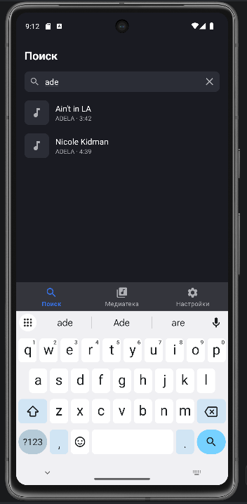
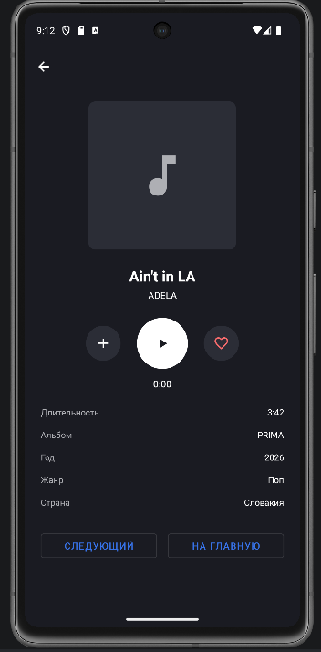
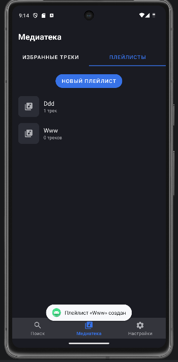
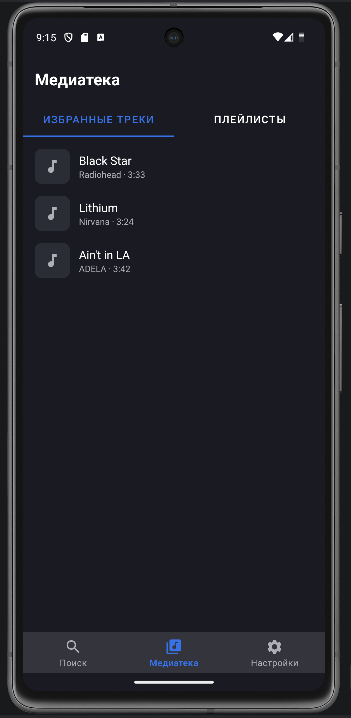
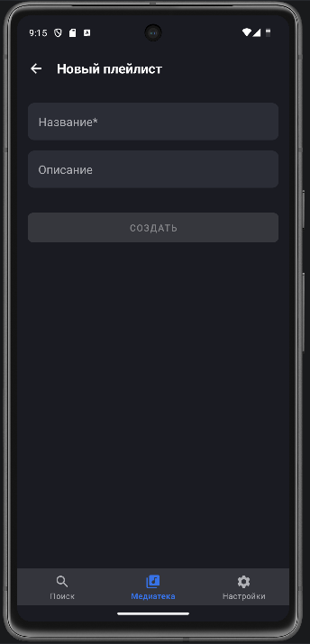

# Playlist Maker

Учебное Android-приложение (Kotlin): музыкальный каталог с поиском, избранным,
плейлистами и экраном плеера. Серверной части и базы данных нет: данные лежат
в памяти (мок-репозиторий), воспроизведение имитируется таймером.

Проект сделан, чтобы отработать **навигацию в Android**: активности, вложенные
фрагменты, back stack и диалоги подтверждения.

## Возможности

| Раздел                    | Что есть |
|---------------------------|----------|
| **Поиск**                 | поиск по названию трека и исполнителю, история последних открытых треков (до 10), очистка истории, удаление трека из каталога с подтверждением |
| **Медиатека → Избранное** | список избранных треков; новые добавляются в начало |
| **Медиатека → Плейлисты** | создание плейлиста, просмотр, удаление трека из плейлиста и самого плейлиста (с подтверждением); при выходе из формы создания с несохранёнными данными приложение спрашивает подтверждение |
| **Плеер**                 | воспроизведение/пауза с бегущим таймером, добавление в избранное, добавление в плейлист через диалог, переход к следующему треку, возврат на главный экран |
| **Настройки**             | переключатель тёмной темы (запоминается между запусками), «Поделиться приложением», «Написать в поддержку» (почтовый клиент), пользовательское соглашение |

## Скриншоты

  

<details>
<summary>Ещё скриншоты</summary>





</details>

## Устройство проекта

```
app/src/main/java/com/example/playlistmaker/
  MainActivity.kt       нижняя навигация, переключение разделов
  SearchFragment.kt     поиск и история
  LibraryFragment.kt    «Медиатека» с вложенными вкладками (childFragmentManager)
  FavoritesFragment.kt, PlaylistsFragment.kt, PlaylistFragment.kt, CreatePlaylistFragment.kt
  PlayerActivity.kt     экран плеера (отдельная Activity)
  SettingsFragment.kt   настройки и тема
  MockRepository.kt     данные в памяти: треки, избранное, история, плейлисты
  Models.kt, App.kt, TrackAdapter.kt, PlaylistAdapter.kt, Utils.kt
```

Что здесь отработано:
- **Навигация:** `FragmentManager`, back stack, вложенные фрагменты внутри «Медиатеки»,
  отдельная `Activity` для плеера, перехват кнопки «Назад» (`OnBackPressedCallback`).
- **UI:** `RecyclerView` с адаптерами, `AlertDialog`, `Toast`, ViewBinding.
- **Настройки:** `SharedPreferences` и применение темы в `Application` до создания экранов.
- **Системные intent'ы:** отправка текста и письма в почтовый клиент.

## Запуск

1. Откройте проект в Android Studio.
2. Дождитесь синхронизации Gradle.
3. Запустите на эмуляторе или телефоне.

## Ограничения

- Данные хранятся только в памяти и **сбрасываются при перезапуске** приложения
  (сохраняется лишь выбранная тема).
- Звука нет: «воспроизведение» это таймер.
- Каталог из 12 вымышленных треков, без обращения к серверу.

## Планы

- Загрузка треков с сервера (Retrofit) и реальное воспроизведение (`MediaPlayer` / ExoPlayer).
- Тесты репозитория.
